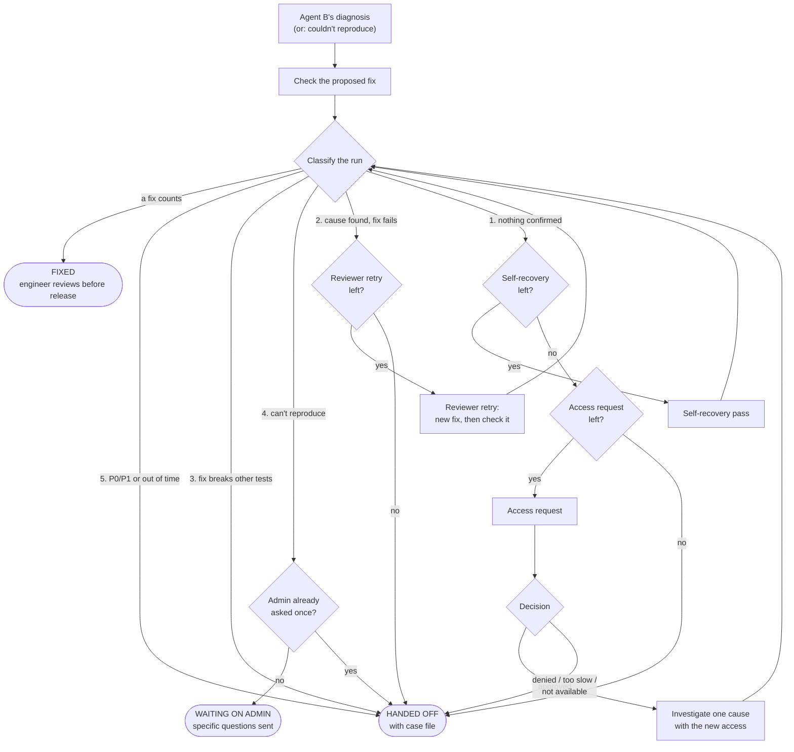

# Troubleshooter: how it works

The troubleshooter is the last stop in the Recreator pipeline. It answers one question:
**Agent B proposed a fix. Does it actually work, and if not, what happens next?**

In short: it checks the fix. If the fix doesn't count, it figures out *why*, tries **once more**
within strict limits, then hands the case to an engineer with a case file that saves them
time. It never loops.

> Spec details, the P0/P1 checklist and the decisions made where the spec was open are in
> [docs/troubleshooter.md](../../docs/troubleshooter.md). This README explains how the code works.

---

## Where it runs

```
Ticket ─► Scrub ─► Triage ─► Agent A: reproduce ─► Agent B: diagnose ─► TROUBLESHOOTER ─► Privacy gate ─► Save
                                   │                                          ▲
                                   └────────── couldn't reproduce ────────────┘
```

`pipeline.py` calls `troubleshoot()` (step 5b) in two situations:

- Agent B returned a diagnosis (suspects plus a proposed patch), **or**
- Agent A couldn't reproduce the bug.

Everything it produces goes into `result["troubleshooting"]`, so the pipeline's existing
privacy gate checks it before anything is saved.

---

## The one rule that decides everything

A fix only **counts** if both are true:

1. The repro script passes with the patch applied (exit 0 instead of 1), and
2. The existing tests still pass.

If no fix counts, the run is a failure, and the troubleshooter's job is to work out which
kind of failure it is.

---

## The loop

The engine (`engine.py`) runs a small loop: **classify → pick the route → take one step →
classify again.**



Every step uses up a one-time allowance, so the loop always ends. On top of that, a run can
never take more than 5 steps.

---

## Step 1: Classify (which of the 5 failures is this?)

`classify.py` looks at the facts and picks **one** reason. It's plain code with no AI, so
the same facts always give the same answer.

| # | Failure | How the code spots it | What happens |
|---|---|---|---|
| 5 | Out of time, or P0/P1 | Ticket severity maps to P0/P1, or the time budget ran out | Engineer takes it now |
| 3 | Fix passes repro, breaks tests | A checked fix passed the repro but failed tests | Engineer takes it now (which behavior to keep is a human call) |
| 4 | Can't reproduce | Agent A said `not_reproduced`, or its script didn't hold up on a fresh sandbox | Ask the admin once, then an engineer |
| 2 | Cause found, no fix works | A cause is `confirmed`, but no fix counts | One Reviewer retry, then an engineer |
| 1 | Nothing confirmed | No cause is `confirmed` | Self-recovery pass, then one access request, then an engineer |

**If more than one fits, the most cautious wins.** The table is in that order: handing off
beats asking the admin, which beats retrying. Other reasons that also matched are kept in the
case file, because they're useful for checking misrouting later.

---

## Step 2: The routes

### Reviewer retry (reason 2)

The cause is known, but the fix didn't work. Agent B gets **one** more try, and this time it
also sees the failed fix and why it failed. Its new patch is checked the same way.
(`agent_steps.make_reviewer`)

### Self-recovery pass (reason 1)

Nothing is confirmed. Using **only the access it already has** (the read-only source tree),
the agent:

1. Re-ranks its remaining guesses based on what was ruled out
2. Checks recent commits on the affected code, since many bugs are regressions
3. Checks the pattern agent's near-misses (stubbed until the pattern agent exists)

(`agent_steps.make_self_recovery`, plus the `recent_commits` tool in `history_tools.py`)

### Access request (reason 1, after self-recovery)

If the self-recovery pass doesn't solve it, the cause is probably outside what the agent can
see. It may ask **once** for read-only access, written in a fixed six-part format:

```
Ruled out:        what was checked, with evidence
Points to:        where the evidence points, and why the agent can't see it now
Asking for:       exactly what read-only access
Expects to find:  what it thinks is there
How it will test: how it'll confirm or rule it out
Limits:           this case only, read-only, expires automatically
```

How this is kept safe (`access.py`):

- **Only listed resources.** The agent picks from a catalog (a JSON file plus two built-in
  sandbox resources: server logs and server config). It can't name an arbitrary folder or
  database.
- **Read-only by design.** The only access kinds are source code, logs, config and deploy
  history. There is no "write" option at all.
- **One case, short-lived.** Granted tools check the grant before every use, and the grant
  is revoked as soon as the investigation ends.
- **A denial is final** for that resource on that case.
- **Too slow is a decision too.** If approval would take longer than the time left (for
  example, another team's code), the request is skipped and the case file lists the access
  an engineer would need.

Who approves depends on `TROUBLESHOOT_APPROVER`. It's `terminal` by default, which asks
whoever is running the pipeline and auto-denies in batch runs.

### Ask the admin (reason 4)

The Recreator side writes 2 to 5 **specific** questions based on what it tried. The case is
parked as `waiting_on_admin`. When the answers are in the ticket and the pipeline reruns,
it's the same case with the same limits, so it can only ask once.

---

## How fixes get checked

`verifier.py` is a slot with three options:

| Verifier | When | What it does |
|---|---|---|
| `NoVerifier` | Default | Can't check, so **no fix ever counts**. The case goes to an engineer with the patch marked "not verified", and the Reviewer retry is skipped because it couldn't prove anything. |
| `CommandVerifier` | `TROUBLESHOOT_VERIFY_CMD` is set | Runs your command with `<patch file> <repro script>` and reads back JSON: `{"repro_passed", "tests_passed", "broken_tests", "notes"}` |
| `RecordedVerifier` | Tests and demos | Gives fixed answers |

Building Mattermost with a patch applied is slow, so that work goes in the command's script
rather than in this code.

---

## Limits (per case, not per run)

| Allowance | Max |
|---|---|
| Self-recovery pass | 1 |
| Access request | 1 |
| Reviewer retry | 1 |
| Rounds of admin questions | 1 |
| Steps in a single run (backstop) | 5 |

"Per case" means earlier runs of the same ticket count too. `runner.load_history()` reads
them from `recreator_runs`, so rerunning a ticket can't reset the limits.

It **stops and hands off** as soon as any of these is true:

- It used its self-recovery pass and its access request
- An access request was denied
- New access produced no new evidence
- The time budget ran out (P2: 60 min, P3: 120 min; placeholders until confirmed)

**Evidence rule:** a cause only becomes `confirmed` or `ruled_out` when the agent says *why*.
A status change with no evidence is ignored and noted in the timeline.

---

## What comes out

### The case file (for the engineer)

Written to `runs/<ticket>_<time>/case_file.md` and `case_file.json`, and **updated after
every step**, so even a crash leaves something useful. It always has these 8 sections:

1. **Problem summary**: what's wrong, expected vs. actual
2. **Repro**: how to trigger it, or what was tried if it couldn't be reproduced
3. **Failure reason**: which of the 5 ended the run
4. **Causes tested**: each cause, confirmed or ruled out, with evidence
5. **Access used**: everything read, plus the access request and its decision
6. **Fixes tried**: each patch and why it didn't count
7. **Remaining guesses**: untested causes, ranked, with the access each needs
8. **Recommended next step**: what to do next

Plus the engineer's options (point the agent somewhere new / work alongside / take over) and
a timeline. It goes through the leak check before it's written; if a real personal value
slips in, a placeholder is written instead.

### The admin status (for the customer)

Plain language, never "the agent failed" (`status.py`):

- **Investigating:** "We're still investigating. Here's what we've checked so far."
- **Need info:** "We need a few details to reproduce this:" followed by the questions
- **Handed off:** "An engineer has your case. Here's what's already been checked, so you won't be asked again."
- **Fixed:** "We found the cause and a fix that passes our checks. An engineer will review it before it's released."

### The result (for Supabase)

`outcome` (`fixed` / `handed_off` / `waiting_on_admin`), `failure_reason`, `stop_rule`,
`budget_used`, the steps taken, the admin messages and the full case file. These are the
fields the eval metrics are measured from.

---

## Walkthrough: the member-count ticket

The mock ticket: *"The header says 3 members, but there are 4 of us."*

1. **Agent A** reproduces it. The repro script exits 1 (bug present).
2. **Agent B** reads the code and lists two suspects: C1 (the count query excludes the
   caller) and C2 (the webapp subtracts deactivated users twice). The code it read rules both
   out, but it still proposes a best-guess patch for C1.
3. **Troubleshooter** checks that patch: the repro still fails. Nothing is confirmed, so
   that's **reason 1**.
4. **Self-recovery pass:** recent commits show nothing relevant, but the evidence points to
   the notification service, which the agent can't read. It's added as C3, untested.
5. **Access request:** read-only logs for the notification service. That team usually takes
   72 hours to approve, which is more than the 2 hours left in the P3 budget, so the request
   is **too slow** and skipped.
6. **Handoff.** The case file lists C1 and C2 as ruled out (with evidence), F1 and why it
   failed, and C3 as the top remaining guess with the exact access it needs. The admin sees:
   *"An engineer has your case. Here's what's already been checked…"*

See it run: `python -m recreator.troubleshooter.demo access_too_slow`

---

## Files

| File | What it does |
|---|---|
| `runner.py` | Entry point (`troubleshoot()`). Turns pipeline objects into the engine's inputs and wires up the real steps |
| `engine.py` | The loop: classify, route, one step, repeat; enforces limits and stop rules |
| `classify.py` | Picks one of the 5 failure reasons (plain rules, most cautious wins) |
| `budget.py` | Priority from severity, time budgets, per-case allowances and history |
| `agent_steps.py` | The Claude-backed steps: Reviewer retry, self-recovery, access planning and investigation, admin questions |
| `access.py` | Catalog, request format, expiring grants, approvers |
| `history_tools.py` | Agent B's read-only source tools plus `recent_commits` |
| `verifier.py` | Checks whether a patch counts (slot with three options) |
| `case_file.py` | Renders and saves the case file (with the leak check) |
| `status.py` | Admin-facing messages |
| `models.py` | Data shapes: causes, fixes, access request, case file, result |
| `config.py` | Settings from environment variables |
| `demo.py` | 15 scripted scenarios covering every route, with no API key or Docker |

**Isolation stays the same as the rest of the pipeline:** the code-side steps only ever see
the technical Handoff, never the customer's ticket text. The admin questions are written on
the Recreator side and never see source code.

---

## Try it

```bash
python -m recreator.troubleshooter.demo                  # every scenario, one line each
python -m recreator.troubleshooter.demo access_denied    # one scenario with its full case file
python -m pytest tests -q                                # the checks behind the spec's P0s
```

On the real pipeline (`python -m recreator.pipeline --ticket 2`), it runs automatically after
Agent B. Before the first real run, add the new column with `sql/troubleshooter_migration.sql`.

## Settings

All in `.env` (see `.env.example`):

| Variable | Default | What it does |
|---|---|---|
| `TROUBLESHOOT_ENABLED` | `true` | Turn the step on or off |
| `TROUBLESHOOT_APPROVER` | `terminal` | Who approves access: `terminal`, `deny`, or `approve` (demos only) |
| `TROUBLESHOOT_ACCESS_CATALOG` | (none) | JSON file of resources that may be requested |
| `TROUBLESHOOT_VERIFY_CMD` | (none) | Command that checks a patch (see above) |
| `TROUBLESHOOT_BUDGET_P2_MIN` / `_P3_MIN` | `60` / `120` | Time budgets in minutes |
| `TROUBLESHOOT_GRANT_TTL_MIN` | `30` | Maximum lifetime of an access grant |
| `TROUBLESHOOT_MAX_STEP_TURNS` | `20` | Claude turns allowed per step |

## Extending it

- **Real patch checking:** write a script that applies the patch, builds the image, reruns
  the repro and runs the tests, then point `TROUBLESHOOT_VERIFY_CMD` at it.
- **More things to request:** add entries to the catalog JSON (`kind`, `description`, `path`,
  `owner_team`, `approval_eta_hours`).
- **Approvals in Teams or Supabase:** write a class with `decide(request, entry)` that returns
  `(decision, who)`, and use it in `runner.build_ports`.
- **Pattern agent near-misses:** pass a `near_misses` function to `make_self_recovery`.
